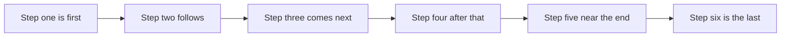

A plain image that is wider than the column:

::figure{id="paired" src="data:image/svg+xml,%3Csvg xmlns=%22http://www.w3.org/2000/svg%22 width=%22640%22 height=%22360%22%3E%3Crect width=%22640%22 height=%22360%22 fill=%22%23e7dfd2%22/%3E%3C/svg%3E" src_dark="data:image/svg+xml,%3Csvg xmlns=%22http://www.w3.org/2000/svg%22 width=%22640%22 height=%22360%22%3E%3Crect width=%22640%22 height=%22360%22 fill=%22%232b2722%22/%3E%3C/svg%3E" alt="A paired figure" caption="A paired figure." zoom="true" width="640" height="360"}

::figure{id="set" images='[{"src":"data:image/svg+xml,%3Csvg xmlns=%22http://www.w3.org/2000/svg%22 width=%22640%22 height=%22360%22%3E%3Crect width=%22640%22 height=%22360%22 fill=%22%23e7dfd2%22/%3E%3C/svg%3E","alt":"First"},{"src":"data:image/svg+xml,%3Csvg xmlns=%22http://www.w3.org/2000/svg%22 width=%22640%22 height=%22360%22%3E%3Crect width=%22640%22 height=%22360%22 fill=%22%23d8e2d0%22/%3E%3C/svg%3E","alt":"Second"},{"src":"data:image/svg+xml,%3Csvg xmlns=%22http://www.w3.org/2000/svg%22 width=%22640%22 height=%22360%22%3E%3Crect width=%22640%22 height=%22360%22 fill=%22%23d0d8e2%22/%3E%3C/svg%3E","alt":"Third"}]' caption="Three images." zoom="true" width="640" height="360"}

A diagram wider than the column:

