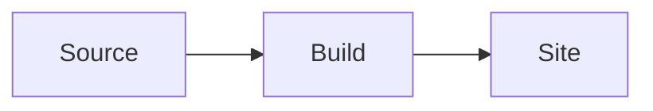

كل مكوّنات القالب في حالتها الافتراضية وأشكالها. المحتوى والتواريخ ثابتة.

## a11y-report

::a11y-report{from=report-example/accessibility}

## backdrop

::backdrop

## badge

::badge{label="New" variant=tip}
::badge{label="Beta" variant=important}
::badge{label="Old" variant=caution}

## bar-chart

::bar-chart{from=bar-chart category=quarter value=users title="Users by quarter"}

## before-after

:::before-after
```ts
const dir = "build";
```

```ts
const dir = "dist";
```
:::

## budget-report

::budget-report{from=report-example/performance targets="js=8000,css=7000"}

## callout

:::callout{type=note title="ملاحظة"}
ملاحظة بشريط تمييز.
:::

:::callout{type=tip title="ملاحظة"}
نصيحة مفيدة.
:::

:::callout{type=important title="ملاحظة"}
ملاحظة مهمة.
:::

:::callout{type=warning title="حذر"}
تحذير.
:::

:::callout{type=caution title="حذر"}
تنبيه حذر.
:::

## cards

Layout component: the home layout draws it from `sections` in front matter, so see the home page of this fixture.

## changelog-entry

:::changelog-entry{version="1.2.0" date="2026-11-09" categories="added,fixed"}
- ثبّت الحزمة.
- شغّل البناء.
:::

## check-list

:::check-list
- `npm run build` — شغّل البناء.
- `npm test` — اقرأ المخرجات.
:::

## cli-demo

:::cli-demo{play}
```sh
$ example install example-package
Installed 1 package
$ example run missing-task
! error: no task named missing-task
```
:::

## code

```ts {2} title="answer.ts" showLineNumbers
const question = "life";
export const answer = 42;
```

Inline `code` in a sentence.

## code-tabs

:::code-tabs{labels='["npm","pnpm"]'}
```bash
npm install mizzen
```

```bash
pnpm add mizzen
```
:::

## cta-band

::cta-band{title="معرض المكوّنات" lead="كل مكوّن في حالته الافتراضية وأشكاله، بمحتوى ثابت." label="الرئيسية" url="/ar/"}

## details

:::details{summary="عرض التفاصيل"}
المحتوى المخفي.
:::

:::details{summary="مفتوح افتراضيًا" open}
المحتوى المخفي.
:::

## diff-block

:::diff-block
```diff
 publish:
-  dir: build
+  dir: dist
 keep:
```
:::

## drift-banner

::drift-banner

## embed

::embed{src="https://example.com/embed" title="Example embed"}

## embed-code

::embed-code{src="/refinement/" title="Example"}

## endpoint

:::endpoint{method=get path="/users/{id}" parameters='[{"name":"id","type":"uuid","required":true,"description":"The user id."}]'}
المحتوى المخفي.
:::

:::endpoint{method=post path="/users"}
المحتوى المخفي.
:::

## feature-grid

Layout component: a layout passes it the `features` list, which Markdown cannot supply yet.

## figure

::figure{src="/assets/gallery.svg" alt="دائرة زرقاء ومستطيل" caption="تعليق على الصورة."}

## file-tree

:::file-tree{label="Project layout"}
- content/ # pages
  - **index.md** # home
- mizzen.yml
:::

## frame

:::frame{title="معرض المكوّنات" caption="تعليق على الصورة."}
المحتوى المخفي.
:::

## guide-summary

::guide-summary

## heading-anchor

### معرض المكوّنات

#### كل مكوّن في حالته الافتراضية وأشكاله، بمحتوى ثابت.

## hero

::hero{eyebrow="ميزة" title="معرض المكوّنات" lead="كل مكوّن في حالته الافتراضية وأشكاله، بمحتوى ثابت." align=start}

::hero{eyebrow="ميزة" title="معرض المكوّنات" lead="كل مكوّن في حالته الافتراضية وأشكاله، بمحتوى ثابت." align=center}

## install-tabs

::install-tabs{package="@velella/lateen"}

## kbd

Press :kbd[Ctrl]+:kbd[K] to search.

## key-value

:::key-value
الإصدار: 1.0
الترخيص: MIT
:::

## link-card

::link-card{href="/ar/" title="الرئيسية" description="بطاقة ترتفع عند المرور."}

## mermaid



## motif

::motif{seed="gallery" pattern="contours"}

## os-tabs

:::os-tabs{id="gallery-os"}
### macOS

```bash
brew install mizzen
```

### ويندوز

```powershell
winget install mizzen
```

### لينكس

```bash
curl -fsSL https://get.mizzen.dev | sh
```
:::

## output-block

:::output-block{label="Build" stream=stdout exit=0 duration=340}
Written 12 pages to dist
:::

## page-status

::page-status{status=deprecated since="0.2" replaced_by="/ar/gallery/"}

## preset-preview

::preset-preview{preset=graphite}

## reading-time

::reading-time{minutes=3 words=600 showWords}

## schema-table

::schema-table{data="schema-table" label="Widget options"}

## stat-strip

::stat-strip

## status

:status[Done]{tone=positive} :status[Late]{tone=negative} :status[Soon]{tone=caution}

## status-banner

::status-banner{status=deprecated replacement="/ar/gallery/" version="0.2.0"}

## status-legend

::status-legend

## steps

:::steps
1. ثبّت الحزمة.
2. شغّل البناء.
3. اقرأ المخرجات.
:::

## symbol-popover

::symbol-popover{name="runExample" signature="runExample(input: Input): Promise<Result>" href="/ar/gallery/"}

## table

| الاسم | العدد |
| --- | ---: |
| ألف | 12 |
| باء | 1,204 |

## tabs

:::tabs{group="gallery-tabs"}
### واحد

التبويب الأول.

### اثنان

التبويب الثاني.
:::

## tags

::tags{items='["دليل",{"label":"مرجع","url":"/ar/gallery/"}]'}

## terminal

:::terminal
$ npm install mizzen
added 1 package

$ npm run build
Built 12 pages.
:::

## tested-chip

::tested-chip{passed=2 failed=0 lastPassed=2026-11-09}

::tested-chip{passed=0 failed=1 lastPassed=2026-11-09}

## trap

:::trap
تنبيه حذر.
:::

## trust-panel

:::trust-panel{level=verified reasons="3 of 3 examples passed|No drift findings" lastReviewer="Ada Lovelace" buildId="build-42" generatedAt="2026-03-06" reviewedAt="2026-03-04"}
:::

:::trust-panel{level=review-due reasons="Reviewed more than 90 days ago."}
:::

## variables-form

::variables-form{id="gallery" group="gallery"}

## version-badge

::version-badge{version=0.3}

::version-badge{version=0.3 variant=changed}

## version-diff

:::version-diff{from="v1" to="v2" changes='[{"kind":"added","title":"Retries"},{"kind":"removed","title":"Legacy flags"},{"kind":"changed","title":"Install"}]'}
:::

## video

::video{src="https://www.youtube.com/watch?v=aqz-KE-bpKQ" title="Example video"}

## wcag-checklist

::wcag-checklist{from=wcag}

## search-result

<ul class="search-result">
<li class="search-result"><span class="search-result-project"><bdi>Handbook</bdi></span><a class="search-result-link" href="/handbook/guide/"><span class="search-result-title">Install the theme</span><span class="search-result-excerpt">Add Lateen to a Mizzen site.</span></a></li>
<li class="search-result"><a class="search-result-link" href="/guide/install/"><span class="search-result-title">Install</span><span class="search-result-excerpt">The first page of this site.</span></a></li>
</ul>

