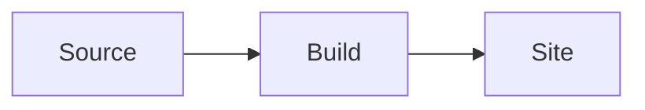

همهٔ مؤلفه‌های پوسته در حالت پیش‌فرض و گونه‌هایشان. محتوا و تاریخ‌ها ثابت‌اند.

## a11y-report

::a11y-report{from=report-example/accessibility}

## backdrop

::backdrop

## badge

::badge{label="New" variant=tip}
::badge{label="Beta" variant=important}
::badge{label="Old" variant=caution}

## bar-chart

::bar-chart{from=bar-chart category=quarter value=users title="Users by quarter"}

## before-after

:::before-after
```ts
const dir = "build";
```

```ts
const dir = "dist";
```
:::

## budget-report

::budget-report{from=report-example/performance targets="js=8000,css=7000"}

## callout

:::callout{type=note title="نکته"}
یک نکته با نوار تأکید.
:::

:::callout{type=tip title="نکته"}
یک نکتهٔ مفید.
:::

:::callout{type=important title="نکته"}
یک نکتهٔ مهم.
:::

:::callout{type=warning title="احتیاط"}
یک هشدار.
:::

:::callout{type=caution title="احتیاط"}
یک هشدار احتیاط.
:::

## cards

Layout component: the home layout draws it from `sections` in front matter, so see the home page of this fixture.

## changelog-entry

:::changelog-entry{version="1.2.0" date="2026-11-09" categories="added,fixed"}
- بسته را نصب کنید.
- ساخت را اجرا کنید.
:::

## charts

::charts{title="Pages by section"}

## check-list

:::check-list
- `npm run build` — ساخت را اجرا کنید.
- `npm test` — خروجی را بخوانید.
:::

## citation

::citation{title="Example citation" url="https://example.com/guide/" source="handbook" date="2026-01-12"}

## cli-demo

:::cli-demo{play}
```sh
$ example install example-package
Installed 1 package
$ example run missing-task
! error: no task named missing-task
```
:::

## code

```ts {2} title="answer.ts" showLineNumbers
const question = "life";
export const answer = 42;
```

Inline `code` in a sentence.

## code-tabs

:::code-tabs{labels='["npm","pnpm"]'}
```bash
npm install mizzen
```

```bash
pnpm add mizzen
```
:::

## cta-band

::cta-band{title="گالری مؤلفه‌ها" lead="هر مؤلفه در حالت پیش‌فرض و گونه‌هایش، با محتوای ثابت." label="خانه" url="/fa/"}

## data-explorer

::data-explorer{from=books columns=title,pages sort=title}

## dated-list

::dated-list{items='[{"date":"2026-03-04","label":"Alpha release"},{"date":"2026-02-11","label":"Beta release"},{"date":"2026-01-09","label":"First preview"}]'}

## details

:::details{summary="نمایش جزئیات"}
محتوای پنهان.
:::

:::details{summary="پیش‌فرض باز" open}
محتوای پنهان.
:::

## diff-block

:::diff-block
```diff
 publish:
-  dir: build
+  dir: dist
 keep:
```
:::

## drift-banner

::drift-banner

## embed

::embed{src="https://example.com/embed" title="Example embed"}

## embed-code

::embed-code{src="/refinement/" title="Example"}

## endpoint

:::endpoint{method=get path="/users/{id}" parameters='[{"name":"id","type":"uuid","required":true,"description":"The user id."}]'}
محتوای پنهان.
:::

:::endpoint{method=post path="/users"}
محتوای پنهان.
:::

## feature-grid

Layout component: a layout passes it the `features` list, which Markdown cannot supply yet.

## figure

::figure{src="/assets/gallery.svg" alt="یک دایرهٔ آبی و یک مستطیل" caption="شرح تصویر."}

## file-tree

:::file-tree{label="Project layout"}
- content/ # pages
  - **index.md** # home
- mizzen.yml
:::

## frame

:::frame{title="گالری مؤلفه‌ها" caption="شرح تصویر."}
محتوای پنهان.
:::

## gallery-filters

Facet filters, sort links and a count for a gallery, as plain links that work without JavaScript.

## gallery-card

مؤلفهٔ چیدمان: چیدمان گالری آن را از رکوردها می‌سازد، پس صفحهٔ گالری ساخته‌شده از داده را ببینید.

## guide-prerequisites

<section class="guide-prerequisites" aria-labelledby="guide-prerequisites-title"><h2 class="guide-prerequisites-title" id="guide-prerequisites-title">پیش‌نیازها</h2><ul class="guide-prerequisites-list"><li class="guide-prerequisites-item"><a href="/install/">نصب Node 24</a></li><li class="guide-prerequisites-item">یک مدیر بسته <span class="guide-prerequisites-optional">اختیاری</span></li></ul></section>

## guide-summary

::guide-summary

## heading-anchor

### گالری مؤلفه‌ها

#### هر مؤلفه در حالت پیش‌فرض و گونه‌هایش، با محتوای ثابت.

## hero

::hero{eyebrow="ویژگی" title="گالری مؤلفه‌ها" lead="هر مؤلفه در حالت پیش‌فرض و گونه‌هایش، با محتوای ثابت." align=start}

::hero{eyebrow="ویژگی" title="گالری مؤلفه‌ها" lead="هر مؤلفه در حالت پیش‌فرض و گونه‌هایش، با محتوای ثابت." align=center}

## install-tabs

::install-tabs{package="@velella/lateen"}

## kbd

Press :kbd[Ctrl]+:kbd[K] to search.

## key-value

:::key-value
نسخه: 1.0
پروانه: MIT
:::

## line-chart

::line-chart{from=line-chart category=month value="north,south" title="Users by month"}

## link-card

::link-card{href="/fa/" title="خانه" description="کارتی که با اشاره بالا می‌آید."}

## mermaid



## motif

::motif{seed="gallery" pattern="contours"}

## os-tabs

:::os-tabs{id="gallery-os"}
### macOS

```bash
brew install mizzen
```

### ویندوز

```powershell
winget install mizzen
```

### لینوکس

```bash
curl -fsSL https://get.mizzen.dev | sh
```
:::

## output-block

:::output-block{label="Build" stream=stdout exit=0 duration=340}
Written 12 pages to dist
:::

## page-status

::page-status{status=deprecated since="0.2" replaced_by="/fa/gallery/"}

## page-tool

A page with `tool: tool.js` loads that browser tool in a named slot and keeps a plain link without JavaScript.

## version-notice

A page outside the default version states its version and links to the equivalent page in the default version.

## performance-chart

::performance-chart

## preset-preview

::preset-preview{preset=graphite}

## quote

:::quote{name="یک بازبین" source="https://example.com/guide/"}
متن در ستون می‌پیچد و در صفحهٔ باریک بریده نمی‌شود.
:::

::quote{text="یک نقل‌قول بدون ارجاع."}

## reading-time

::reading-time{minutes=3 words=600 showWords}

## record-table

::record-table{from=books caption="کتاب‌ها" columns='[{"field": "title", "label": "عنوان"}, {"field": "pages", "label": "صفحه", "kind": "number"}, {"field": "published", "label": "انتشار", "kind": "date"}]'}

## schema-table

::schema-table{data="schema-table" label="Widget options"}

## stat-strip

::stat-strip

## state

::state{kind=empty description="هنوز نوشته‌ای نیست."}

## status

:status[Done]{tone=positive} :status[Late]{tone=negative} :status[Soon]{tone=caution}

## status-banner

::status-banner{status=deprecated replacement="/fa/gallery/" version="0.2.0"}

## status-legend

::status-legend

## steps

:::steps
1. بسته را نصب کنید.
2. ساخت را اجرا کنید.
3. خروجی را بخوانید.
:::

## symbol

برای اجرا از :symbol[runExample]{signature="runExample(): void" href="/fa/gallery/"} استفاده کنید.

## symbol-popover

::symbol-popover{name="runExample" signature="runExample(input: Input): Promise<Result>" href="/fa/gallery/"}

## table

| نام | تعداد |
| --- | ---: |
| الف | 12 |
| ب | 1,204 |

## tabs

:::tabs{group="gallery-tabs"}
### یک

برگهٔ اول.

### دو

برگهٔ دوم.
:::

## term

اصطلاح درون‌متنی :term[Build]{id=build} و :term[واژهٔ ناشناخته] بدون مدخل.

## tags

::tags{items='["راهنما",{"label":"مرجع","url":"/fa/gallery/"}]'}

## terminal

:::terminal
$ npm install mizzen
added 1 package

$ npm run build
Built 12 pages.
:::

## tested-chip

::tested-chip{passed=2 failed=0 lastPassed=2026-11-09}

::tested-chip{passed=0 failed=1 lastPassed=2026-11-09}

## timeline

::timeline{from=timeline caption="خط زمانی پروژه"}

## trap

:::trap
یک هشدار احتیاط.
:::

## trust-panel

:::trust-panel{level=verified reasons="3 of 3 examples passed|No drift findings" lastReviewer="Ada Lovelace"}
:::

:::trust-panel{level=review-due reasons="Reviewed more than 90 days ago."}
:::

## variables-form

::variables-form{id="gallery" group="gallery"}

## version-badge

::version-badge{version=0.3}

::version-badge{version=0.3 variant=changed}

## version-diff

:::version-diff{from="v1" to="v2" changes='[{"kind":"added","title":"Retries"},{"kind":"removed","title":"Legacy flags"},{"kind":"changed","title":"Install"}]'}
:::

## video

::video{src="https://www.youtube.com/watch?v=aqz-KE-bpKQ" title="Example video"}

## wcag-checklist

::wcag-checklist{from=wcag}

## search-result

<ul class="search-result">
<li class="search-result"><span class="search-result-project"><bdi>Handbook</bdi></span><a class="search-result-link" href="/handbook/guide/"><span class="search-result-path"><bdi>/handbook/</bdi></span><span class="search-result-title">Install the theme</span><span class="search-result-excerpt">Add Lateen to a Mizzen site.</span></a></li>
<li class="search-result"><a class="search-result-link" href="/guide/install/"><span class="search-result-path"><bdi>/guide/</bdi></span><span class="search-result-title">Install</span><span class="search-result-excerpt">The first page of this site.</span></a></li>
</ul>


## chart-data

جدول بستهٔ داده زیر هر نمودار؛ خود نمودارها آن را می‌سازند.

## compare

::compare{from=books ids="a,b" fields='[{"field": "pages", "label": "Pages", "kind": "number"}, {"field": "published", "label": "Published", "kind": "date"}]'}

## glossary

::glossary

## related-guides

راهنماهای قبلی، بعدی و مرتبط در پایان صفحهٔ راهنما.

## stacked-bar

::stacked-bar{from=stacked-bar category=category series=series value=value title="درآمد به تفکیک منطقه"}

## brand-studio

::brand-studio
